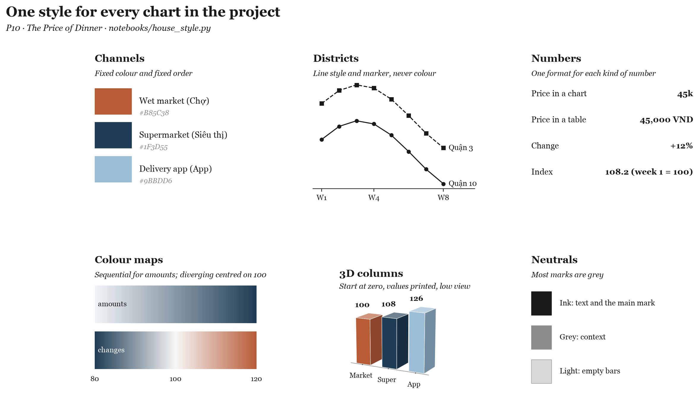
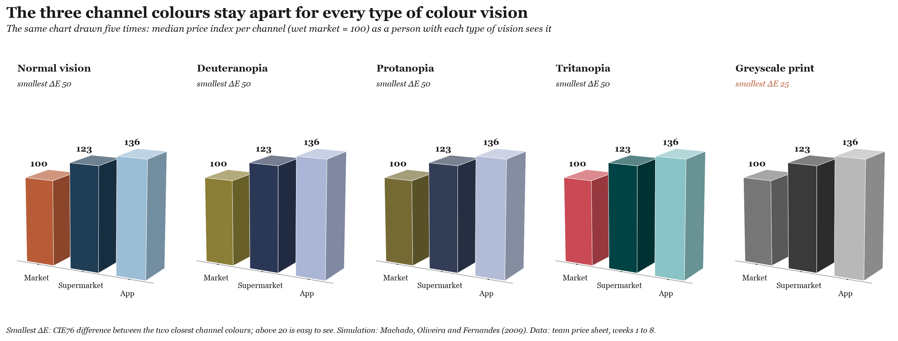
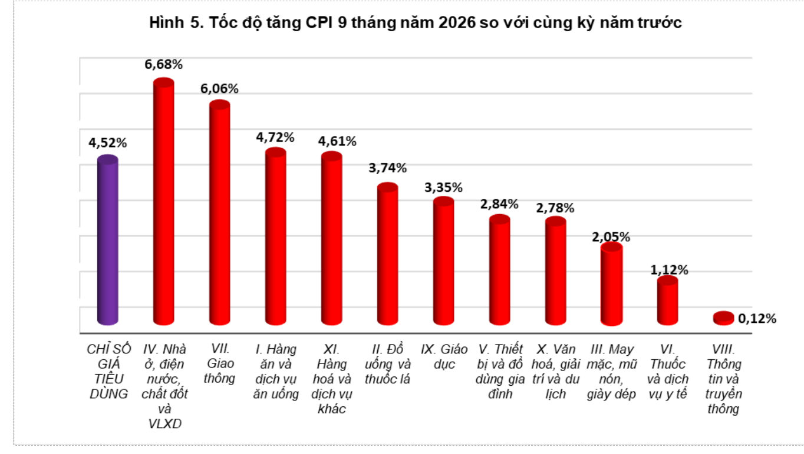
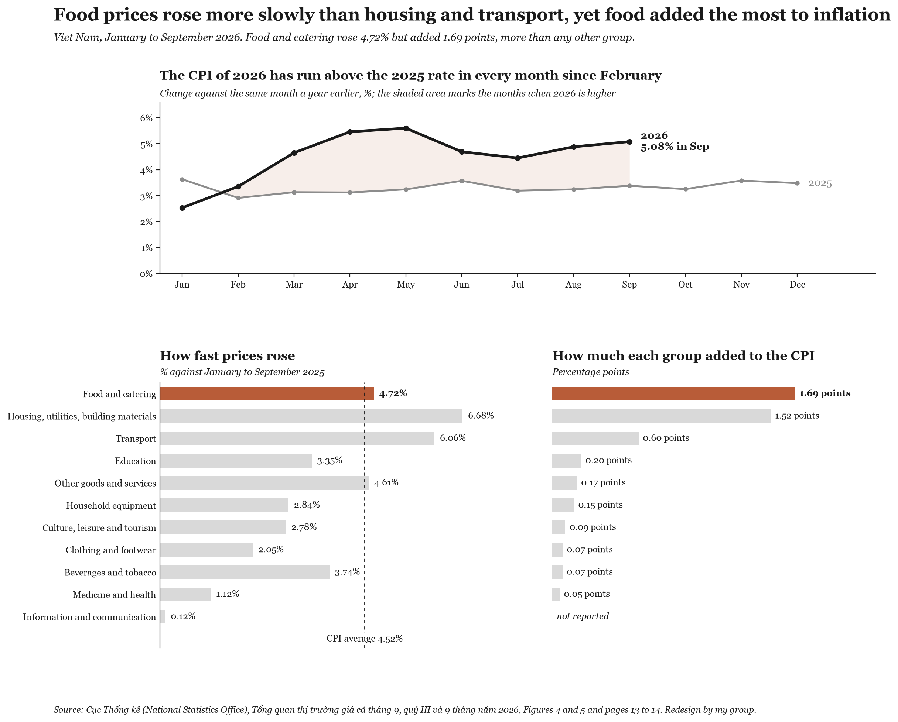
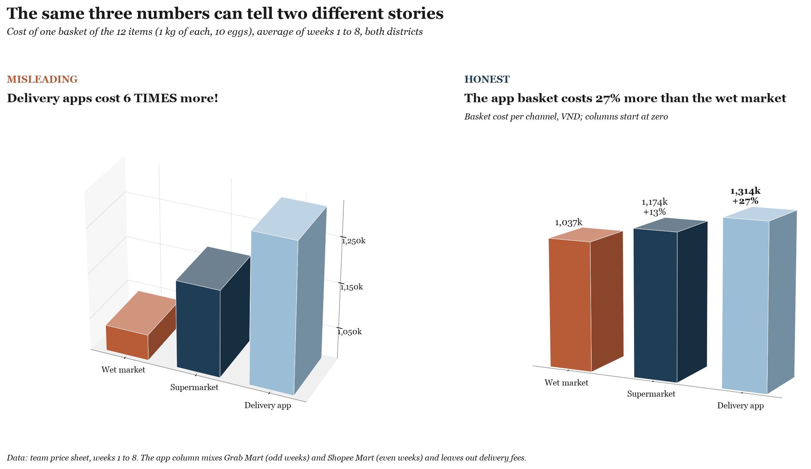

# M3 · House style and design taste

**Project:** P10 · The Price of Dinner
**Module lead (Design lead):** *(fill in)*
**Last update:** 15 November 2026

This page collects the evidence for Module M3 for the report. The code is in Module M3 of `notebooks/P10_Final_Team10.ipynb`, and every figure is in `report/figures/`.

## 1. House style

Every notebook starts with `from house_style import *` and `apply_style()`. The figure `m3_house_style.png` shows the whole style on one page.

| Element | Rule in my group's style | Reason |
|---|---|---|
| Channels | Wet market #B85C38 (terracotta), supermarket #1F3D55 (dark blue), delivery app #9BBDD6 (light blue), always in this order | The channel is the main category in our project, so it gets the only colours. A fixed order and fixed colours let a reader learn them once |
| Districts | Quận 10 uses a solid line or a circle; Quận 3 uses a dashed line or a square | A second set of colours would double the colours on a chart |
| Amounts | Sequential map from very light grey to dark blue | Lightness alone shows more or less |
| Changes | Diverging map from dark blue through near white to terracotta, centred at 100 for an index and at 0 for a percentage | The centre shows "no change", and the two sides show falls and rises |
| Neutrals | Ink #1A1A1A for text and the main mark, grey #8C8C8C for context, light grey #D9D9D9 for empty bars | Most marks stay grey, so the one highlighted mark carries the finding |
| Text | Serif font: Georgia, or Gelasio from `notebooks/fonts` on a computer whose Georgia lacks Vietnamese letters (Gelasio has the letter widths of Georgia); bold title that states the finding, italic subtitle with the units, source line at the bottom | The reader gets the message from the title and the units from the subtitle |
| Numbers | "45k" in charts, "45,000 VND" in tables, "+12%" for changes, "108.2 (week 1 = 100)" for an index | One format for each kind of number avoids confusion |
| Labels | Labels sit next to the data; a legend is the last choice | The eye does not need to move between the chart and a legend |
| 3D columns | A chart that compares a few magnitudes uses 3D columns from `bars3d()`: a light top, the base colour in front, darker sides; columns start at zero, key values are printed, the view stays low. Every other idiom (lines, dot plots, dumbbells, heatmaps, biplots, dendrograms, dashboard panels) stays flat | One look for every comparison of magnitudes, kept honest by three fixed rules, while each other task keeps the idiom that fits it |

## 2. Colour vision and greyscale check

My group simulated protanopia, deuteranopia and tritanopia with the matrices of Machado, Oliveira and Fernandes (2009), and also converted the colours to greyscale. For each case, `cvd_report()` measures the smallest difference (CIE76 ΔE) between two channel colours. A ΔE above about 20 is easy to see on a screen.

| Vision | Smallest ΔE between two channel colours |
|---|---|
| Normal | 50 |
| Deuteranopia | 50 |
| Protanopia | 50 |
| Tritanopia | 50 |
| Greyscale | 25 |

**The check changed our palette.** The first palette used #2C4F6B for the supermarket and #8FB3CF for the app. It passed all three colour vision tests, but in greyscale the wet market and the supermarket were only 17 ΔE apart. My group made the supermarket blue darker and the app blue lighter, and the greyscale difference rose to 25. My group also writes the channel name next to the marks in every final chart, so no reader depends on colour alone.

## 3. Makeover of a press chart about inflation

**Original.** Figure 5 on page 13 of *Tổng quan thị trường giá cả tháng 9, quý III và 9 tháng năm 2026* by the Cục Thống kê (National Statistics Office), published on 3 October 2026. My group first planned this makeover in Group Homework 3.

The critique table with six named principles, the hand sketch and the code of the redesign are in Section M3.3 of `notebooks/P10_Final_Team10.ipynb`.

**Text (150 words).** The original Figure 5 draws eleven CPI groups as red 3D cylinders and the national average as a purple bar beside them. The 3D shading breaks the data ink principle, because the reader must guess where each oval top ends, and the purple bar breaks Gestalt similarity, because it looks like a twelfth group. The chart also fails its task: the text asks which groups pushed the CPI up, but the bars show only how fast prices rose. My group redrew it with flat horizontal bars on a zero baseline and the average as a dashed line. A second aligned panel shows how many points each group added to the CPI. Food and catering is the only coloured group, and the title states the finding: food prices rose more slowly than housing and transport, yet food added the most to inflation, because it weighs most in the basket.

## 4. Honest and misleading pair

Both charts show the same three numbers: the cost of one basket of our twelve items in each channel. The basket holds 1 kg of each item sold by weight (tofu included) and 10 eggs, at the average price of weeks 1 to 8 in both districts.

| | Misleading chart | Honest chart |
|---|---|---|
| Form | 3D columns, steep view, no values | 3D columns, low view, values printed |
| Value axis | Starts at about 980,000 VND | Starts at zero |
| What the eye sees | The app column is about six times as tall as the wet market column | The app column is about 27% taller than the wet market column |
| Title | "Delivery apps cost 6 TIMES more!" | "The app basket costs 27% more than the wet market" |
| Labels | None, the reader must guess from the axis | The cost and the gap against the wet market sit on each bar |

**How the misleading chart misleads.** It uses the 3D column style of spreadsheet tools and a cut axis. A bar chart asks the reader to compare lengths. When the axis starts just below the cheapest basket, the reader compares only the tops of the bars, and a gap of 27% makes the app column look about six times as tall as the wet market column. The title repeats the false ratio. In Tufte's terms, the Lie Factor of the left chart is far above 1.

**How a reader can spot it.** The reader can check the lowest number on the y axis. If it is not zero, the bar lengths do not show the values. The reader can also divide the two values on the axis instead of trusting the picture.

**A limit of both charts.** The app basket leaves out the delivery fee, about 23,000 VND for one order on average in weeks 1 to 8. Chart 6 of M4 adds the fee and shows it as a separate part of the bar.
